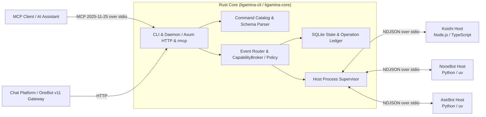

<div align="center">

# Ligamina

**One runtime, multiple chatbot plugin ecosystems. Reuse native plugins without rebuilding their worlds.**

**English** | [简体中文](https://www.google.com/search?q=./README.zh-CN.md)

</div>

## Overview

[Ligamina](https://github.com/Enoa-devteam/Ligamina) is a multi-framework chatbot plugin runtime and compatibility lab designed around a single principle:

> *One runtime, multiple chatbot plugins ecosystems. Reuse native plugins without rebuilding their worlds.*

A **Rust Core** supervisor orchestrates isolated, framework-native host processes so that **Koishi**, **NoneBot**, and **AstrBot** plugins run directly inside their original frameworks—without modifying plugin source code and while preserving native command parsing, middleware, permissions, and storage.

Alongside the runtime, Ligamina ships a reproducible **Compatibility Lab** that locks official plugin catalogs by hash (frozen catalogs), executes install, load, and behavioral verification inside network-disabled OS-isolated workers (such as Linux Docker and Windows Sandbox), and binds every report entry to exact plugin versions, artifact hashes, lockfiles, and test cases.

## Core Usage Modes

1. **Plugins as Tools (MCP Mode)**  
   Exposes plugin commands across all supported frameworks through a unified Model Context Protocol (`2025-11-25`) server using the `cmd.<host>.<command>` naming convention (alongside `_ligamina_ping` for health checks). Each invocation runs in a virtual private chat session with a 30-second execution deadline (`TOOL_DEADLINE`), ready for AI coding assistants and any MCP-compatible client.
2. **Plugins for Bots (Gateway Mode)**  
   Runs as a background `daemon` with an Event Router and HTTP Gateway (such as OneBot v11 Gateway) to ingest chat events and route them to the target framework host.

## Architecture

The Rust Core communicates with every language host strictly via **NDJSON over stdio**, keeping cross-language boundaries explicit and reserving `stdout` exclusively for protocol frames:



**Core Rust Subsystems** ([crates/ligamina-core](https://github.com/Enoa-devteam/Ligamina/tree/main/crates/ligamina-core) & [crates/ligamina-cli/src](https://github.com/Enoa-devteam/Ligamina/tree/main/crates/ligamina-cli/src)):

- **`runtime.rs` & `supervisor.rs`**: Runtime lifecycle orchestration and host subprocess startup, monitoring, and restart management.
- **`broker.rs` & `policy.rs`**: `CapabilityBroker` mediation and security/permission policy enforcement.
- **`commands.rs` & `command_args.rs`**: Unified cross-host command catalog and structured argument schema parsing.
- **`router/`, `store/`, `transport/`, `deployment/`, `platform.rs`**: Event routing, bundled SQLite (`rusqlite`) state & Operation Ledger persistence, NDJSON stdio transport, and isolated deployment management.
- **`ligamina-contracts` & `contracts/`**: Shared cross-language protocol contracts and JSON Schemas.

## Supported Native Hosts

| Host | Directory | Runtime & Locked Stack | Worker Entrypoint | Native Event Bridge |
| :--- | :--- | :--- | :--- | :--- |
| **Koishi** | [hosts/koishi](https://github.com/Enoa-devteam/Ligamina/tree/main/hosts/koishi) | Node.js `24.20.0` (recommended), TypeScript, `@koishijs/core` `4.18.11`, Satori APIs, `@minatojs/driver-sqlite` `4.7.0` | `node dist/worker.js` | Wraps incoming events into native Satori `Session` objects via `Bot.session()`, dispatches them through `Bot.dispatch()`, and maps typed arguments and options to MCP tool fields. |
| **NoneBot** | [hosts/nonebot](https://github.com/Enoa-devteam/Ligamina/tree/main/hosts/nonebot) | Python `3.12.14`, `uv`, `nonebot2` `2.5.0`, `nonebot-adapter-onebot` `2.4.6` | `uv run --locked --python 3.12.14 python -m ligamina_nonebot.worker` | Receives Ligamina event envelopes over stdio and invokes `Adapter.json_to_event` and `Bot.handle_event` directly to drive `on_command` / `on_shell_command` matchers without opening a real OneBot network connection. |
| **AstrBot** | [hosts/astrbot](https://github.com/Enoa-devteam/Ligamina/tree/main/hosts/astrbot) | Python `3.12.14`, `uv`, unmodified `astrbot==4.29.1` (`AGPL-3.0-or-later`) | Built-in stdio worker lifecycle | Points `ASTRBOT_ROOT` and working directory to the host data directory in `ligamina_astrbot/lifecycle.py` before importing AstrBot; runs the full lifecycle via a bridge platform adapter while blocking built-in admin commands. |

## Current Status & Compatibility Matrix

Ligamina only claims capabilities backed by reproducible verification:

| Area | Status | Notes & Evidence |
| :--- | :--- | :--- |
| **Rust Core, Koishi / NoneBot Hosts, HTTP & MCP** | Working | Passed Phase 1 acceptance. |
| **MCP Command Tools (Koishi, NoneBot, AstrBot)** | Working | **18/18** tool-level tests passing inside a network-disabled Linux worker. |
| **AstrBot Host** | Pilot Verified | Runs on unmodified `astrbot 4.29.1`; **3,265** catalog plugins frozen, **21/24** pilot install/load succeeded, **24/24** tool-level behavioral tests passing. |
| **Catalog-wide Compatibility** | Unclaimed | Full-catalog compatibility is not yet claimed. |
| **Real-platform Delivery** | Unclaimed | Production live-platform delivery is not yet claimed. |
| **Windows Sandbox Enforcement** | Blocked / In Progress | Currently blocked and not yet enforced as a production path. |

## Security Model & Isolation Boundaries

- **Reserved Tool Accounts**: MCP tool sessions run under reserved accounts that are strictly prohibited from Gateway ingress or authorization flows.
- **No Automatic Replay on Ambiguity**: Deliveries with uncertain outcomes stay in an `unknown` state and are never automatically replayed.
- **Offline Hash-Pinned Execution**: Third-party plugins are installed and tested only inside hash-pinned, network-disabled OS-isolated workers.
- **Secret Hygiene & Clean `stdout`**: Tokens are never written to logs or reports, and `stdout` is strictly reserved for NDJSON protocol messages.
- **Loopback-Only Admin Endpoints**: `status` and `doctor` commands accept loopback HTTP URLs only (`http://127.0.0.1:<port>`) and require `LIGAMINA_ADMIN_TOKEN`.

## Quick Start

### 1. Prerequisites

- **Rust**: `1.97.1` (pinned in [rust-toolchain.toml](https://github.com/Enoa-devteam/Ligamina/blob/main/rust-toolchain.toml) with `rustfmt` and `clippy`, Rust Edition `2024`)
- **Node.js & npm**: `24.20.0` recommended (for the Koishi host)
- **Python & uv**: `3.12.14` with `uv` (for the NoneBot and AstrBot hosts)

### 2. Build Core & Sync Hosts

```bash
# 1. Build the Rust CLI and core runtime
cargo build -p ligamina-cli --locked

# 2. Install and build the Koishi host
cd hosts/koishi && npm ci && npm run build
cd ../..

# 3. Sync the NoneBot host Python environment
uv sync --locked --project hosts/nonebot --python 3.12.14

# 4. Sync the AstrBot host Python environment
uv sync --locked --project hosts/astrbot --python 3.12.14
```

### 3. CLI & MCP Usage

Implemented in [crates/ligamina-cli/src/main.rs](https://github.com/Enoa-devteam/Ligamina/blob/main/crates/ligamina-cli/src/main.rs) and [crates/ligamina-cli/src/mcp.rs](https://github.com/Enoa-devteam/Ligamina/blob/main/crates/ligamina-cli/src/mcp.rs):

```bash
# Default mode (no subcommand): start the MCP server over stdio (MCP 2025-11-25)
# Exposes _ligamina_ping and cmd.<host>.<command> tools (30s TOOL_DEADLINE)
ligamina-cli

# Start the background daemon and HTTP Gateway with a config file
ligamina-cli daemon --config <path.json>

# Inspect runtime status (loopback HTTP only; requires LIGAMINA_ADMIN_TOKEN)
LIGAMINA_ADMIN_TOKEN=<your-token> ligamina-cli status --url http://127.0.0.1:<port>

# Run health diagnostics (loopback HTTP only; requires LIGAMINA_ADMIN_TOKEN)
LIGAMINA_ADMIN_TOKEN=<your-token> ligamina-cli doctor --url http://127.0.0.1:<port>

# Parse and print compatibility/gate test reports
ligamina-cli report <report.json> --format text --gate compatibility
# Options: --format json|text|ndjson, --gate completion|automation|compatibility
```

### 4. Verification Scripts

Use [init.ps1](https://github.com/Enoa-devteam/Ligamina/blob/main/init.ps1) or `init.sh` in `docs` mode (`node scripts/check-docs.mjs`) or `full` mode (also runs `scripts/check.ps1` for full runtime verification):

```bash
# Linux / macOS
bash init.sh docs
bash init.sh full
```

```powershell
# Windows PowerShell
pwsh -NoProfile -File init.ps1 -Mode docs
pwsh -NoProfile -File init.ps1 -Mode full
```

## Repository Structure

| Path | Description |
| :--- | :--- |
| [crates/](https://github.com/Enoa-devteam/Ligamina/tree/main/crates) | Rust workspace: [ligamina-core](https://github.com/Enoa-devteam/Ligamina/tree/main/crates/ligamina-core), [ligamina-cli](https://github.com/Enoa-devteam/Ligamina/tree/main/crates/ligamina-cli/src), and `ligamina-contracts` |
| `contracts/` | Cross-language protocol contracts and schemas |
| [hosts/](https://github.com/Enoa-devteam/Ligamina/tree/main/hosts) | Native framework hosts: [koishi](https://github.com/Enoa-devteam/Ligamina/tree/main/hosts/koishi), [nonebot](https://github.com/Enoa-devteam/Ligamina/tree/main/hosts/nonebot), and [astrbot](https://github.com/Enoa-devteam/Ligamina/tree/main/hosts/astrbot) |
| `catalogs/`, `recipes/`, `lab/`, `config/lab/`, `outputs/` | Compatibility Lab frozen catalogs, test recipes, isolation harness, lab configs, and outputs |
| [samples/](https://github.com/Enoa-devteam/Ligamina/tree/main/samples) | Sample fixtures (`fixtures/`), offline service profiles (`profiles/`), and `third-party.lock.json` |
| `clients/reference/`, `deploy/`, `docs/`, `scripts/` | Reference clients, deployment configs, documentation, and automation scripts |
| [Cargo.toml](https://github.com/Enoa-devteam/Ligamina/blob/main/Cargo.toml) & [rust-toolchain.toml](https://github.com/Enoa-devteam/Ligamina/blob/main/rust-toolchain.toml) | Rust workspace manifest (`tokio`, `axum`, `rmcp`, `rusqlite`, `jsonschema`, etc.) and pinned toolchain |

## License

This repository is licensed under **AGPL-3.0** as declared in the root `LICENSE` file (note that `hosts/astrbot` also integrates `astrbot==4.29.1`, licensed under `AGPL-3.0-or-later`).
