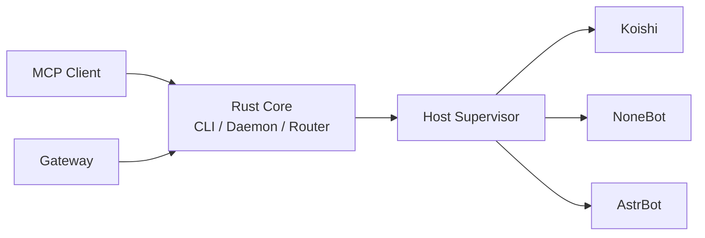

<div align="center">

# Ligamina

**One runtime, multiple chatbot plugin ecosystems. Reuse native plugins without rebuilding their worlds.**

**English** | [简体中文](./README.zh-CN.md)

</div>

## Overview

[Ligamina](https://github.com/Enoa-devteam/Ligamina) is a multi-framework chatbot plugin runtime and compatibility lab. A **Rust Core** supervisor orchestrates isolated, framework-native host processes so that **Koishi**, **NoneBot**, and **AstrBot** plugins run directly inside their original frameworks—without modifying plugin source code and while preserving native command parsing, middleware, permissions, and storage.

The companion **Compatibility Lab** locks official plugin catalogs by hash, executes install, load, and behavioral verification inside network-disabled OS-isolated workers, and binds every result to exact plugin versions, artifact hashes, lockfiles, and test cases.

## Core Usage Modes

1. **Plugins as Tools (MCP Mode)**: Exposes plugin commands through a unified Model Context Protocol (`2025-11-25`) server using the `cmd.<host>.<command>` naming convention (plus `_ligamina_ping` for health checks). Each invocation runs in a virtual private chat session under a 30-second `TOOL_DEADLINE`.
2. **Plugins for Bots (Gateway Mode)**: Runs as a background `daemon` with an Event Router and HTTP Gateway (such as OneBot v11 Gateway) to ingest chat events and route them to the target framework host.

## Architecture

The Rust Core communicates with every language host strictly via **NDJSON over stdio**, reserving `stdout` exclusively for protocol frames:



Core modules live in [crates/ligamina-core](https://github.com/Enoa-devteam/Ligamina/tree/main/crates/ligamina-core) and [crates/ligamina-cli/src](https://github.com/Enoa-devteam/Ligamina/tree/main/crates/ligamina-cli/src): `supervisor.rs`/`runtime.rs` manage lifecycle and subprocess supervision, `broker.rs`/`policy.rs` enforce capability mediation and policy, `commands.rs` maintains the cross-host command catalog, and `router/`/`store/`/`transport/` handle event routing, SQLite ledgers, and stdio transport.

## Supported Native Hosts

| Host | Directory | Runtime & Locked Stack | Worker Entrypoint |
| :--- | :--- | :--- | :--- |
| **Koishi** | [hosts/koishi](https://github.com/Enoa-devteam/Ligamina/tree/main/hosts/koishi) | Node.js `24.20.0`, TypeScript, `@koishijs/core` `4.18.11` | `node dist/worker.js` |
| **NoneBot** | [hosts/nonebot](https://github.com/Enoa-devteam/Ligamina/tree/main/hosts/nonebot) | Python `3.12.14`, `uv`, `nonebot2` `2.5.0`, `nonebot-adapter-onebot` `2.4.6` | `uv run --locked --python 3.12.14 python -m ligamina_nonebot.worker` |
| **AstrBot** | [hosts/astrbot](https://github.com/Enoa-devteam/Ligamina/tree/main/hosts/astrbot) | Python `3.12.14`, `uv`, unmodified `astrbot==4.29.1` | Built-in stdio worker lifecycle |

## Current Status

Ligamina only claims capabilities backed by reproducible verification. Generated phase results and their detailed evidence are maintained separately in [Acceptance Results](docs/evidence/acceptance-results.md); the table below is a short status index.

| Area | Status | Notes |
| :--- | :--- | :--- |
| **Rust Core, Koishi / NoneBot Hosts, HTTP & MCP** | Working | Passed Phase 1 acceptance. |
| **MCP Command Tools** | Working | **18/18** tool-level tests passing in a network-disabled Linux worker. |
| **AstrBot Host** | Pilot Verified | **3,265** catalog plugins frozen, **21/24** pilot installs loaded, **24/24** tool-level behavioral tests passing. |
| **Catalog-wide Compatibility** | Unclaimed | Full-catalog compatibility is not yet claimed. |
| **Real-platform Delivery** | Unclaimed | Production live-platform delivery is not yet claimed. |
| **Windows Sandbox Enforcement** | Blocked | Not yet enforced as a production path. |

## Security Model

- **Reserved Tool Accounts**: MCP tool sessions use reserved accounts that Gateway ingress or authorization flows must never reuse.
- **No Automatic Replay on Ambiguity**: Deliveries with uncertain outcomes stay `unknown` and are never replayed automatically.
- **Offline Hash-Pinned Execution**: Third-party plugins run only in hash-pinned, network-disabled OS-isolated workers.
- **Secret Hygiene & Clean `stdout`**: Tokens never enter logs or reports; host and MCP `stdout` is reserved for NDJSON frames.
- **Loopback-Only Admin Endpoints**: `status` and `doctor` accept loopback HTTP URLs only and require `LIGAMINA_ADMIN_TOKEN`.

## Quick Start

Prerequisites: **Rust** `1.97.1` (pinned in [rust-toolchain.toml](https://github.com/Enoa-devteam/Ligamina/blob/main/rust-toolchain.toml)), **Node.js/npm** `24.20.0`, and **Python/uv** `3.12.14`.

```bash
cargo build -p ligamina-cli --locked
(cd hosts/koishi && npm ci && npm run build)
uv sync --locked --project hosts/nonebot --python 3.12.14
uv sync --locked --project hosts/astrbot --python 3.12.14
```

The default mode starts the MCP server over stdio; the same binary also runs the daemon, admin commands, and report parsing:

```bash
ligamina-cli
ligamina-cli daemon --config <path.json>
LIGAMINA_ADMIN_TOKEN=<token> ligamina-cli status --url http://127.0.0.1:<port>
LIGAMINA_ADMIN_TOKEN=<token> ligamina-cli doctor --url http://127.0.0.1:<port>
ligamina-cli report <report.json> --format text --gate compatibility
```

Run `bash init.sh docs` or `bash init.sh full` for documentation and runtime checks (on Windows: `pwsh -NoProfile -File init.ps1 -Mode docs|full`). See [Bot & Agent Integration](docs/guides/bot-integration.md) for host wiring.

## Repository Structure

| Path | Description |
| :--- | :--- |
| [crates/](https://github.com/Enoa-devteam/Ligamina/tree/main/crates) | Rust workspace: core runtime, CLI, and `ligamina-contracts` |
| `contracts/`, `hosts/` | Cross-language protocol contracts and native framework hosts |
| `catalogs/`, `recipes/`, `lab/`, `outputs/` | Frozen catalogs, test recipes, isolation harness, and lab outputs |
| [samples/](https://github.com/Enoa-devteam/Ligamina/tree/main/samples), `clients/reference/`, `deploy/`, `docs/`, `scripts/` | Samples, reference clients, deployment, documentation, and automation |

## License

This repository is licensed under **AGPL-3.0** as declared in the root `LICENSE` file (note that `hosts/astrbot` also integrates `astrbot==4.29.1`, licensed under `AGPL-3.0-or-later`).
