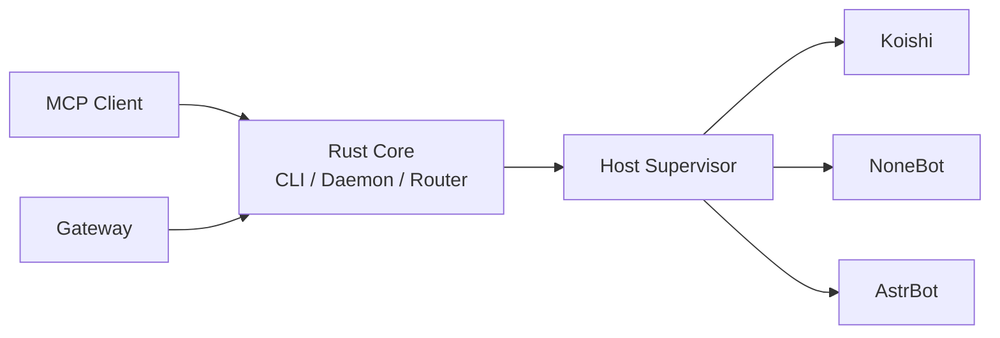

<div align="center">

# Ligamina

**多框架聊天机器人插件运行时与兼容性测试实验室**

[English](./README.md) | **简体中文**

</div>

## 项目简介

[Ligamina](https://github.com/Enoa-devteam/Ligamina) 是面向多生态聊天机器人插件的统一运行时（Runtime）与兼容性测试实验室（Compatibility Lab）。它通过 **Rust Core** 监管进程编排隔离的原生框架宿主（Host），让 **Koishi**、**NoneBot** 与 **AstrBot** 插件在原生框架中直接运行，保留原有命令解析、中间件、权限模型与本地存储。

兼容性实验室将官方插件目录锁定为固定哈希快照，在断网的 OS 隔离 Worker 中执行安装、加载与行为验证，并把结果绑定到精确的插件版本、产物哈希、依赖锁与测试用例。

## 核心使用模式

1. **Plugins as Tools（MCP 模式）**：通过内置 MCP（`2025-11-25`）服务端，把各框架插件命令暴露为 `cmd.<host>.<command>` 工具（另有 `_ligamina_ping` 健康检查）；每次调用在受控虚拟私聊会话中执行，受 30 秒 `TOOL_DEADLINE` 约束。
2. **Plugins for Bots（Gateway 模式）**：以后台 `daemon`、事件路由器与 HTTP Gateway（如 OneBot v11 Gateway）接收聊天事件，并路由至对应原生框架宿主。

## 系统架构

Rust Core 与各语言宿主严格通过 **NDJSON over stdio** 通信，`stdout` 仅用于协议帧：



核心模块见 [crates/ligamina-core](https://github.com/Enoa-devteam/Ligamina/tree/main/crates/ligamina-core) 与 [crates/ligamina-cli/src](https://github.com/Enoa-devteam/Ligamina/tree/main/crates/ligamina-cli/src)：`supervisor.rs`/`runtime.rs` 管理生命周期与子进程监控，`broker.rs`/`policy.rs` 负责能力代理与权限策略，`commands.rs` 维护跨宿主命令目录，`router/`/`store/`/`transport/` 分别负责事件路由、SQLite 状态账本与 stdio 传输。

## 原生框架宿主

| 宿主 | 目录 | 运行时与锁定依赖 | 启动方式 |
| :--- | :--- | :--- | :--- |
| **Koishi** | [hosts/koishi](https://github.com/Enoa-devteam/Ligamina/tree/main/hosts/koishi) | Node.js `24.20.0`、TypeScript、`@koishijs/core` `4.18.11` | `node dist/worker.js` |
| **NoneBot** | [hosts/nonebot](https://github.com/Enoa-devteam/Ligamina/tree/main/hosts/nonebot) | Python `3.12.14`、`uv`、`nonebot2` `2.5.0`、`nonebot-adapter-onebot` `2.4.6` | `uv run --locked --python 3.12.14 python -m ligamina_nonebot.worker` |
| **AstrBot** | [hosts/astrbot](https://github.com/Enoa-devteam/Ligamina/tree/main/hosts/astrbot) | Python `3.12.14`、`uv`、未修改的 `astrbot==4.29.1` | 内置 stdio worker 生命周期 |

## 安全模型

- **保留工具账号隔离**：MCP 工具会话使用专用保留账号，Gateway 入口与外部授权流程不得复用。
- **投递状态保守处理**：结果不确定的投递保留为 `unknown`，系统不会自动重放。
- **断网与哈希锁定**：第三方插件仅在固定版本/哈希且断网的 OS 隔离 Worker 中安装和测试。
- **凭据与协议通道保护**：日志与报告不记录敏感 Token，宿主与 MCP 的 `stdout` 仅用于 NDJSON 协议帧。
- **本地管理面限制**：`status` 与 `doctor` 仅接受本地回环 HTTP 地址，并校验 `LIGAMINA_ADMIN_TOKEN`。

## 快速开始

依赖：**Rust** `1.97.1`（[rust-toolchain.toml](https://github.com/Enoa-devteam/Ligamina/blob/main/rust-toolchain.toml) 锁定，含 `rustfmt`、`clippy`）、**Node.js/npm** `24.20.0`、**Python/uv** `3.12.14`。

```bash
cargo build -p ligamina-cli --locked
(cd hosts/koishi && npm ci && npm run build)
uv sync --locked --project hosts/nonebot --python 3.12.14
uv sync --locked --project hosts/astrbot --python 3.12.14
```

默认模式通过 stdio 启动 MCP 服务端；也可运行 daemon、管理接口与报告解析：

```bash
ligamina-cli
ligamina-cli daemon --config <path.json>
LIGAMINA_ADMIN_TOKEN=<token> ligamina-cli status --url http://127.0.0.1:<port>
LIGAMINA_ADMIN_TOKEN=<token> ligamina-cli doctor --url http://127.0.0.1:<port>
ligamina-cli report <report.json> --format text --gate compatibility
```

文档检查与运行时验证：`bash init.sh docs` / `bash init.sh full`（Windows 使用 `pwsh -NoProfile -File init.ps1 -Mode docs|full`）。更多接入说明见 [Bot 与 Agent 接入](docs/guides/bot-integration.md) 与[英文 README](README.md)。

## 验收结果

以下摘要由 `node scripts/render-readme.mjs` 从验收 JSON 生成，检查时校验漂移；各级别定义见 [兼容性实验](docs/guides/compatibility.md)。未列出的能力不作兼容性声明。

### 第一阶段

<!-- ligamina:phase1:start -->
验收日期：2026-10-12。C01–C15：15/15；G1：**PASS**；G2：**PASS**。

固定代表样本每平台 20 个；以下按级别展示 **通过 / 失败 / 跳过或未执行 / 未知**，分母均为 20。加载与联邦派发通过数分别保留，行为支持只看 L4。

| 级别 | Windows | WSL Linux |
| --- | --- | --- |
| L0 | 20 / 0 / 0 / 0 | 17 / 3 / 0 / 0 |
| L1 | 18 / 2 / 0 / 0 | 15 / 2 / 3 / 0 |
| L2 | 14 / 4 / 2 / 0 | 12 / 3 / 5 / 0 |
| L3 | 14 / 0 / 6 / 0 | 12 / 0 / 8 / 0 |
| L4 | 4 / 0 / 16 / 0 | 4 / 0 / 16 / 0 |

| 生态 | 已通过行为验证的精确插件版本 |
| --- | --- |
| nonebot | nonebot-plugin-autohelp == 0.1.7 |
| nonebot | nonebot-plugin-repeater == 3.1.4 |
| koishi | koishi-plugin-game-mini == 0.4.3 |
| koishi | koishi-plugin-multi-qa == 1.0.8 |

证据：[T18 最终审阅](outputs/acceptance/t18-final-audit-20261012.json)、[Windows 20 样本](outputs/acceptance/t13-representative-windows-full-20261010.json)、[WSL Linux 20 样本](outputs/acceptance/t13-representative-wsl-final-20261010.json)。

稳定性与安装依据：[WSL 24 小时 / 200 恢复循环](outputs/acceptance/t14-stability-linux-wsl-100x24h-20261011.json)、[Windows Sandbox C14](outputs/acceptance/t15-windows-sandbox-c14-20261011.json)、[Linux 容器 smoke](outputs/acceptance/t16-linux-wsl-container-20261010.json)。

范围：虚拟 Gateway、已锁定 Host/profile 和上述行为用例；未连接真实 QQ/其他平台网关。Linux 容器结果是本机 WSL 发起的 smoke。四个版本的支持不能外推为商店全集兼容。
<!-- ligamina:phase1:end -->

### 第二阶段

<!-- ligamina:phase2:start -->
状态截至 2026-10-17T02:36:00+08:00：S2-01–S2-09 pilot 执行已完成；128 个结果位置闭合（通过 / 失败 / 跳过 / 未知：4 / 11 / 88 / 25）。NoneBot Linux、Koishi Linux 和 Windows 各 30 个目录 entry 已进入 L1/L2 pilot。 冻结快照 `p2-41649744e057d61031d5` 含 **5,690 entries**（NoneBot 943、Koishi 4,747；官方维护子集 55）。

| 任务 | 状态 |
| --- | --- |
| S2-01–S2-08 | 已完成并分别保存验收证据 |
| S2-09 | pilot 执行完成：128/128 位置闭合；通过 / 失败 / 跳过 / 未知 4 / 11 / 88 / 25；自动化与行为 gate 保留 blocker |
| S2-10 | 已完成 |
| S2-11 | 已完成：复跑 512/512 shards、11,380/11,380 单元；单元通过 / 失败 / 跳过 / 未知 0 / 880 / 7530 / 2970 |
| S2-12 | 已完成 |

分类 dry run 只建议 69/5690 entries，5621 项仍是 `unmapped_category`。S2-09 的 128 个双 OS 结果位置全部闭合：四个历史支持版本和 60 个分层目录 entry 分别保留状态；NoneBot Linux 尝试 21 个 Docker Worker（L1 {"passed":21,"failed":0,"skipped":0,"unknown":0}；L2 {"passed":16,"failed":3,"skipped":2,"unknown":0}），Koishi Linux 尝试 22 个 Docker Worker（L1 {"passed":22,"failed":0,"skipped":0,"unknown":0}；L2 {"passed":18,"failed":4,"skipped":0,"unknown":0}），Windows 尝试 22 个 Sandbox Worker（L1 {"passed":22,"failed":0,"skipped":0,"unknown":0}；L2 {"passed":18,"failed":4,"skipped":0,"unknown":0}）。

Windows Sandbox 的 CPython 启动仍受 App Control（Win32 4551）阻止；Node.js 24.20.0 签名 runtime 已用于 Windows Koishi L1/L2 pilot。Koishi Windows Job Object commit P95 6.25 GiB（8 GiB 限额内），scratch P95 136.0 MiB；预算仍 provisional，NoneBot Windows 无 Worker 样本。目录 cohort 缺 entry-bound behavior fixture，L4 未评估，不能外推为兼容。S2-10 正式 census 已记账闭合 11,380/11,380 个 entry×OS 单元，512/512 个 shard；Linux shard 0/256 为 16/16 单元、shard 1/256 为 24/24 单元、shard 2/256 为 28/28 单元；Windows shard 0/256 为 26/26（通过 / 失败 / 跳过 / 未知：0 / 1 / 22 / 3），shard 1/256 为 22/22（通过 / 失败 / 跳过 / 未知：0 / 2 / 17 / 3）。当前执行 shard：无。独立 smoke shard 不计入正式分母。这仅表示记账完整，不表示兼容通过。真实平台登录、发送与投递验收未执行。
S2-11 同冻结快照复跑截至 2026-10-17T02:25:14+08:00：512/512 份 canonical 报告、11,380/11,380 单元；单元通过 / 失败 / 跳过 / 未知 0 / 880 / 7530 / 2970，复跑已完成，无剩余报告、单元或活动执行。SQLite 阶段作业状态另计（通过 / 失败 / 跳过 / 未知 / queued / leased：24914 / 880 / 37357 / 5129 / 0 / 0）；阶段作业通过不代表插件单元兼容通过。单元只有六个选定阶段全部 passed 才会记为 passed；本轮所有 11,380 单元的 federated 和 compare 均 skipped，因此单元通过数为 0。P2-AUTOMATION 受已知 Worker/平台 unknown 阻塞；P2-BEHAVIOR、P2-FIELD 未验证，详见 S2-12 审计和兼容矩阵。

证据：[目录快照](outputs/acceptance/phase2-catalog-snapshot-20261012.json)、[分类 dry run](outputs/acceptance/phase2-s206-20261012.json)、[调度验收](outputs/acceptance/phase2-s207-20261012.json)、[S2-07 实际 CLI 计划](outputs/acceptance/phase2-s207-cli-smoke-20261012.json)、[S2-08 报告验收](outputs/acceptance/phase2-s208-20261012.json)、[S2-09 baseline](outputs/acceptance/phase2-s209-baseline-20261012.json)、[S2-09 pilot 清单](outputs/acceptance/phase2-s209-pilot-manifest-20261012.json)、[S2-09 pilot 结果](outputs/acceptance/phase2-s209-20261012.json)、[S2-10 baseline](outputs/acceptance/phase2-s210-baseline-20261012.json)、[S2-10 实现验证](outputs/acceptance/phase2-s210-implementation-20261012.json)、[S2-10 smoke shard](outputs/acceptance/phase2-s210-census-linux-shard0of256-smoke-20261012.json)、[S2-10 正式 Linux shard 0](outputs/acceptance/phase2-s210-census-linux-shard0of256-20261012.json)、[S2-10 正式 Linux shard 1](outputs/acceptance/phase2-s210-census-linux-shard1of256-20261012.json)、[S2-10 正式 Linux shard 2](outputs/acceptance/phase2-s210-census-linux-shard2of256-20261012.json)、[S2-10 正式 Windows shard 0](outputs/acceptance/phase2-s210-census-windows-shard0of256-20261012.json)、[S2-10 正式 Windows shard 1](outputs/acceptance/phase2-s210-census-windows-shard1of256-20261012.json)、[Windows 首次投影 attempt](outputs/acceptance/phase2-s210-census-windows-shard0of256-attempt1-20261012.json)、[S2-10 当前未闭合汇总](outputs/acceptance/phase2-s210-census-interim-20261012.json)、[S2-11 复跑 checkpoint](outputs/acceptance/phase2-s211-process-exit-regression-20261014.json)、[S2-12 审计](outputs/acceptance/phase2-s212-audit-20261017.json)、[兼容矩阵](outputs/acceptance/phase2-s212-compatibility-matrix-20261017.md)、[完整实施计划](docs/plans/2026-10-12-phase-2-full-catalog.md)。
<!-- ligamina:phase2:end -->

### 第三阶段

<!-- ligamina:phase3:start -->
P3-01–P3-10 工程与报告交付已推进至 P3-10；这不代表五道门均通过，也不扩张插件支持范围。

P3-05 受影响账本：3,179/3,179 唯一单位有终态；通过 / 失败 / 跳过 / 未知 1299 / 688 / 1139 / 53；健康 gate blocked。
P3-08 双平台行为账本：120 个位置、360 个三次尝试槽，实际派发 0 次；可执行 Host fixture 缺失，P3-BEHAVIOR 保持 not evaluated。

| Gate | 裁决 | 范围与边界 |
| --- | --- | --- |
| P3-ENGINE | **passed_scoped** | Windows catalog_plugin_claims_allowed=false |
| P3-RECOVERY | **blocked** | 53 terminal unknown outcomes remain: Linux 39, Windows 14. |
| P3-AUTOMATION | **blocked** | The same 53 P3-05 unknowns block automation health. |
| P3-BEHAVIOR | **not_evaluated** | 0 attempts dispatched; all 120 positions lack executable Host event/setup bindings. |
| P3-FIELD | **not_run** | No real-platform acceptance was included in this plan. |

证据：[P3-10 gate audit](outputs/acceptance/phase3-p310-gate-audit-20261026.json)、[3,179 单位兼容与执行矩阵](outputs/acceptance/phase3-p310-compatibility-matrix-20261026.md)、[P3-08 行为账本](outputs/acceptance/phase3-p308-behavior-accounting-20261026.json)。审计 SHA-256 `716efa2e9af8537506e26215c231ef68bf8b30585d61e070bffff76237692b90`；矩阵 SHA-256 `7b777a2e4cc23f499c7b0b5ba49001126fdb87d71d08f1b14d46022e9d130b3d`.
Windows 结果仅适用于已记录的 Evaluation/Audit Mode Worker profile；没有强制模式、全目录行为兼容或真实平台投递结论。
<!-- ligamina:phase3:end -->
