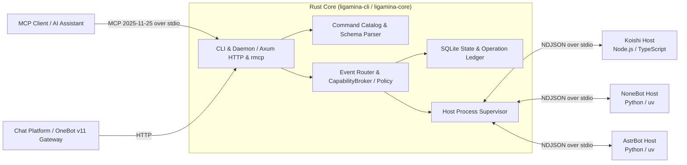

<div align="center">

# Ligamina

**多框架聊天机器人插件运行时与兼容性测试实验室**

[English](https://www.google.com/search?q=./README.md) | **简体中文**

</div>

## 项目简介

[Ligamina](https://github.com/Enoa-devteam/Ligamina) 是一个面向多生态聊天机器人插件的统一运行时（Runtime）与兼容性测试实验室（Compatibility Lab）。

它通过一个 **Rust Core** 监管进程统一编排并隔离不同语言的原生框架宿主进程（Host），在不修改原插件代码的前提下，直接在其原生框架中运行 **Koishi**、**NoneBot** 和 **AstrBot** 插件，完整保留各框架原有的命令解析、中间件、权限模型与本地存储机制。

同时，Ligamina 内置了可复现的兼容性测试实验室：将官方插件目录锁定为固定哈希快照（Frozen Catalogs），在断网的操作系统级隔离 Worker（如 Linux Docker、Windows Sandbox）中执行安装、加载与行为级验证，并将每条测试结果严格绑定至精确的插件版本、产物哈希、依赖锁与测试用例。

## 核心使用模式

Ligamina 提供两种互补的运行模式，既面向 AI Agent 工具调用，也面向传统聊天机器人事件分发：

1. **Plugins as Tools（插件即工具 / MCP 模式）**  
   通过内置的 MCP（Model Context Protocol，`2025-11-25`）服务端，将不同框架的原生插件命令统一暴露为标准 MCP 工具（命名格式为 `cmd.<host>.<command>`，附带 `_ligamina_ping` 健康检查工具）。每次工具调用均在受控的虚拟私聊会话中执行，并受 30 秒超时上限（`TOOL_DEADLINE`）约束，可直接接入 AI 编程助手或任意 MCP 客户端。
2. **Plugins for Bots（插件供机器人使用 / Gateway 模式）**  
   通过后台守护进程（`daemon`）、事件路由器（Event Router）与 Gateway HTTP（如 OneBot v11 Gateway）接收外部聊天事件，并将事件信封路由至对应的原生框架宿主进行处理。

## 系统架构

Rust Core 与各个语言宿主进程之间严格通过 **NDJSON over stdio** 通信，确保跨语言边界清晰、无隐式状态共享，且 `stdout` 专用于协议帧传输：



**Rust 核心模块职责**（详见 [crates/ligamina-core](https://github.com/Enoa-devteam/Ligamina/tree/main/crates/ligamina-core) 与 [crates/ligamina-cli/src](https://github.com/Enoa-devteam/Ligamina/tree/main/crates/ligamina-cli/src)）：

- **`runtime.rs` & `supervisor.rs`**：管理整体运行时生命周期，以及各宿主子进程的拉起、健康监控与故障重启。
- **`broker.rs` & `policy.rs`**：实现能力代理（`CapabilityBroker`）与安全/权限策略校验。
- **`commands.rs` & `command_args.rs`**：维护跨宿主统一命令目录，并将插件命令参数解析为结构化 Schema。
- **`router/`、`store/`、`transport/`、`deployment/`、`platform.rs`**：分别负责事件路由、基于内置 SQLite（`rusqlite`）的状态与操作账本（Operation Ledger）持久化、NDJSON stdio 传输层及隔离部署管理。
- **`ligamina-contracts` & `contracts/`**：集中定义 Rust Core 与各语言 Host 之间的跨语言协议与数据契约。

## 原生框架宿主实现

| 宿主 | 目录 | 运行时与锁定依赖 | 启动方式 | 核心事件桥接机制 |
| :--- | :--- | :--- | :--- | :--- |
| **Koishi** | [hosts/koishi](https://github.com/Enoa-devteam/Ligamina/tree/main/hosts/koishi) | Node.js `24.20.0`（推荐）、TypeScript、`@koishijs/core` `4.18.11`、Satori APIs、`@minatojs/driver-sqlite` `4.7.0` | `node dist/worker.js` | 通过 `Bot.session()` 将事件封装为原生 Satori `Session`，经 `Bot.dispatch()` 分发给原生插件，并将类型化参数与选项映射为 MCP 工具字段。 |
| **NoneBot** | [hosts/nonebot](https://github.com/Enoa-devteam/Ligamina/tree/main/hosts/nonebot) | Python `3.12.14`、`uv`、`nonebot2` `2.5.0`、`nonebot-adapter-onebot` `2.4.6` | `uv run --locked --python 3.12.14 python -m ligamina_nonebot.worker` | 经 stdio 接收事件信封，直接调用 `Adapter.json_to_event` 与 `Bot.handle_event` 驱动 `on_command` / `on_shell_command` 匹配器，无需建立真实 OneBot 网络连接。 |
| **AstrBot** | [hosts/astrbot](https://github.com/Enoa-devteam/Ligamina/tree/main/hosts/astrbot) | Python `3.12.14`、`uv`、未修改的 `astrbot==4.29.1`（`AGPL-3.0-or-later`） | 内置 stdio worker 生命周期入口 | 在 `ligamina_astrbot/lifecycle.py` 中先将 `ASTRBOT_ROOT` 与工作目录指向宿主数据目录再导入原版 AstrBot；通过桥接平台适配器运行完整生命周期，并屏蔽内置管理员命令。 |

## 项目现状与兼容性进展

Ligamina 坚持“仅声明经可复现测试验证的能力”，当前各模块状态如下：

| 模块 / 能力 | 当前状态 | 说明与验证记录 |
| :--- | :--- | :--- |
| **Rust Core、Koishi / NoneBot Hosts、HTTP & MCP** | 可用（Working） | 已通过 Phase 1 验收测试。 |
| **MCP 命令工具（Koishi、NoneBot、AstrBot）** | 可用（Working） | 在断网 Linux Worker 中完成 **18/18** 工具级行为测试。 |
| **AstrBot Host** | 试点可用（Pilot Verified） | 基于未修改的 `astrbot 4.29.1` 运行；已冻结 **3,265** 个插件目录快照，试点安装/加载 **21/24** 成功，工具级行为测试 **24/24** 通过。 |
| **全目录级兼容性（Catalog-wide Compatibility）** | 未声明（Unclaimed） | 尚未对全部冻结目录做出全量兼容声明。 |
| **真实平台投递（Real-platform Delivery）** | 未声明 / 演进中 | 生产级真实聊天平台投递尚未声明就绪。 |
| **Windows Sandbox 强制隔离执行** | 受阻 / 演进中 | 当前仍存在环境限制，未作为默认强制路径声明。 |

## 安全模型与隔离边界

- **保留工具账号隔离**：MCP 工具会话使用专用保留账号，严禁 Gateway 入口或任何外部授权流程复用该账号。
- **投递状态保守处理**：任何结果不确定的消息或操作投递均保留为 `unknown` 状态，系统绝不自动重放，避免产生重复副作用。
- **断网与哈希锁定隔离**：第三方插件仅允许在固定版本/产物哈希且禁用网络的 OS 隔离 Worker 中执行安装与测试。
- **凭据与协议通道保护**：所有日志与报告均不记录敏感 Token；各宿主进程与 MCP 通道的 `stdout` 严格保留给 NDJSON 协议帧，避免日志污染协议流。
- **本地管理面限制**：`status` 与 `doctor` 管理接口仅允许访问本地回环 HTTP 地址（`http://127.0.0.1:<port>`），并强制校验 `LIGAMINA_ADMIN_TOKEN`。

## 快速开始

### 1. 环境准备

- **Rust**：`1.97.1`（由 [rust-toolchain.toml](https://github.com/Enoa-devteam/Ligamina/blob/main/rust-toolchain.toml) 锁定，包含 `rustfmt` 与 `clippy`，Rust Edition `2024`）
- **Node.js & npm**：推荐 `24.20.0`（用于构建 Koishi Host）
- **Python & uv**：`3.12.14` 与 `uv`（用于同步并运行 NoneBot / AstrBot Host）

### 2. 构建核心与各宿主环境

```bash
# 1. 构建 Rust CLI 与核心运行时
cargo build -p ligamina-cli --locked

# 2. 安装并编译 Koishi Host
cd hosts/koishi && npm ci && npm run build
cd ../..

# 3. 同步 NoneBot Host Python 环境
uv sync --locked --project hosts/nonebot --python 3.12.14

# 4. 同步 AstrBot Host Python 环境
uv sync --locked --project hosts/astrbot --python 3.12.14
```

### 3. CLI 与 MCP 使用方式

CLI 入口实现位于 [crates/ligamina-cli/src/main.rs](https://github.com/Enoa-devteam/Ligamina/blob/main/crates/ligamina-cli/src/main.rs) 与 [crates/ligamina-cli/src/mcp.rs](https://github.com/Enoa-devteam/Ligamina/blob/main/crates/ligamina-cli/src/mcp.rs)：

```bash
# 默认模式（无子命令）：通过 stdio 启动 MCP 服务端（MCP 2025-11-25）
# 暴露 _ligamina_ping 与各宿主的 cmd.<host>.<command> 工具（单次调用超时 30s）
ligamina-cli

# 按配置文件启动后台守护进程与 HTTP Gateway
ligamina-cli daemon --config <path.json>

# 查询运行状态（仅限本地回环 HTTP，需设置 LIGAMINA_ADMIN_TOKEN）
LIGAMINA_ADMIN_TOKEN=<your-token> ligamina-cli status --url http://127.0.0.1:<port>

# 执行健康诊断（仅限本地回环 HTTP，需设置 LIGAMINA_ADMIN_TOKEN）
LIGAMINA_ADMIN_TOKEN=<your-token> ligamina-cli doctor --url http://127.0.0.1:<port>

# 解析并输出兼容性/门禁测试报告
ligamina-cli report <report.json> --format text --gate compatibility
# 支持参数：--format json|text|ndjson，--gate completion|automation|compatibility
```

### 4. 运行验证脚本

仓库根目录提供 [init.ps1](https://github.com/Enoa-devteam/Ligamina/blob/main/init.ps1) 与 `init.sh`，支持 `docs`（运行 `node scripts/check-docs.mjs`）和 `full`（额外执行 `scripts/check.ps1` 完整运行时验证）两种模式：

```bash
# Linux / macOS
bash init.sh docs
bash init.sh full
```

```powershell
# Windows PowerShell
pwsh -NoProfile -File init.ps1 -Mode docs
pwsh -NoProfile -File init.ps1 -Mode full
```

## 目录结构

| 路径 | 说明 |
| :--- | :--- |
| [crates/](https://github.com/Enoa-devteam/Ligamina/tree/main/crates) | Rust Workspace：包含 [ligamina-core](https://github.com/Enoa-devteam/Ligamina/tree/main/crates/ligamina-core)、[ligamina-cli](https://github.com/Enoa-devteam/Ligamina/tree/main/crates/ligamina-cli/src) 与 `ligamina-contracts` |
| `contracts/` | 跨语言协议与数据 Schema 定义 |
| [hosts/](https://github.com/Enoa-devteam/Ligamina/tree/main/hosts) | 原生框架宿主实现：[koishi](https://github.com/Enoa-devteam/Ligamina/tree/main/hosts/koishi)、[nonebot](https://github.com/Enoa-devteam/Ligamina/tree/main/hosts/nonebot)、[astrbot](https://github.com/Enoa-devteam/Ligamina/tree/main/hosts/astrbot) |
| `catalogs/`、`recipes/`、`lab/`、`config/lab/`、`outputs/` | 兼容性测试实验室：冻结插件目录清单、测试配方、隔离测试框架、实验配置与输出产物 |
| [samples/](https://github.com/Enoa-devteam/Ligamina/tree/main/samples) | 示例配置、测试夹具（`fixtures/`）、离线服务配置（`profiles/`）及 `third-party.lock.json` |
| `clients/reference/`、`deploy/`、`docs/`、`scripts/` | 参考客户端、部署模板、项目文档与自动化检查脚本 |
| [Cargo.toml](https://github.com/Enoa-devteam/Ligamina/blob/main/Cargo.toml) & [rust-toolchain.toml](https://github.com/Enoa-devteam/Ligamina/blob/main/rust-toolchain.toml) | Rust 工作区依赖清单（`tokio`、`axum`、`rmcp`、`rusqlite`、`jsonschema` 等）与工具链版本锁定 |

## 许可证

本仓库遵循根目录 `LICENSE` 文件声明的 **AGPL-3.0** 许可证（其中 `hosts/astrbot` 集成的 `astrbot==4.29.1` 同样采用 `AGPL-3.0-or-later`）。

