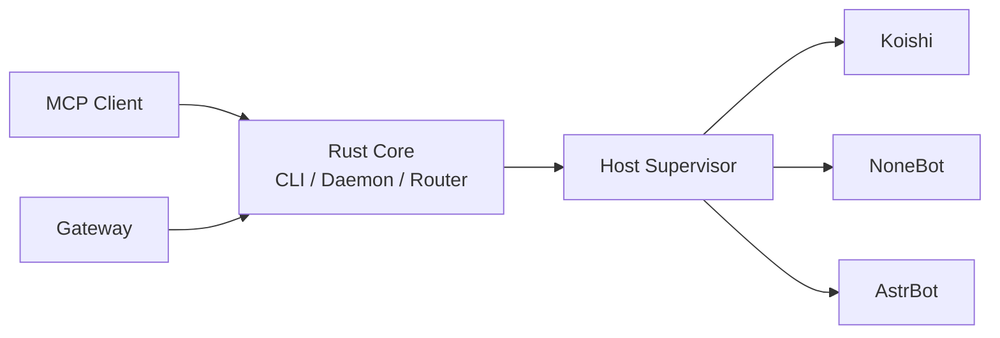

<div align="center">

# Ligamina

**多框架聊天机器人插件运行时与兼容性测试实验室**

[English](./README.md) | **简体中文**

</div>

## 项目简介

[Ligamina](https://github.com/Enoa-devteam/Ligamina) 是面向多生态聊天机器人插件的统一运行时（Runtime）与兼容性测试实验室（Compatibility Lab）。它通过 **Rust Core** 监管进程编排隔离的原生框架宿主（Host），让 **Koishi**、**NoneBot** 与 **AstrBot** 插件在原生框架中直接运行，保留原有命令解析、中间件、权限模型与本地存储。

兼容性实验室将官方插件目录锁定为固定哈希快照，在断网的 OS 隔离 Worker 中执行安装、加载与行为验证，并把结果绑定到精确的插件版本、产物哈希、依赖锁与测试用例。

## 核心使用模式

1. **Plugins as Tools（MCP 模式）**：通过内置 MCP（`2025-11-25`）服务端，把各框架插件命令暴露为 `cmd.<host>.<command>` 工具（另有 `_ligamina_ping` 健康检查）；每次调用在受控虚拟私聊会话中执行，受 30 秒 `TOOL_DEADLINE` 约束。
2. **Plugins for Bots（Gateway 模式）**：以后台 `daemon`、事件路由器与 HTTP Gateway（如 OneBot v11 Gateway）接收聊天事件，并路由至对应原生框架宿主。

## 系统架构

Rust Core 与各语言宿主严格通过 **NDJSON over stdio** 通信，`stdout` 仅用于协议帧：



核心模块见 [crates/ligamina-core](https://github.com/Enoa-devteam/Ligamina/tree/main/crates/ligamina-core) 与 [crates/ligamina-cli/src](https://github.com/Enoa-devteam/Ligamina/tree/main/crates/ligamina-cli/src)：`supervisor.rs`/`runtime.rs` 管理生命周期与子进程监控，`broker.rs`/`policy.rs` 负责能力代理与权限策略，`commands.rs` 维护跨宿主命令目录，`router/`/`store/`/`transport/` 分别负责事件路由、SQLite 状态账本与 stdio 传输。

## 原生框架宿主

| 宿主 | 目录 | 运行时与锁定依赖 | 启动方式 |
| :--- | :--- | :--- | :--- |
| **Koishi** | [hosts/koishi](https://github.com/Enoa-devteam/Ligamina/tree/main/hosts/koishi) | Node.js `24.20.0`、TypeScript、`@koishijs/core` `4.18.11` | `node dist/worker.js` |
| **NoneBot** | [hosts/nonebot](https://github.com/Enoa-devteam/Ligamina/tree/main/hosts/nonebot) | Python `3.12.14`、`uv`、`nonebot2` `2.5.0`、`nonebot-adapter-onebot` `2.4.6` | `uv run --locked --python 3.12.14 python -m ligamina_nonebot.worker` |
| **AstrBot** | [hosts/astrbot](https://github.com/Enoa-devteam/Ligamina/tree/main/hosts/astrbot) | Python `3.12.14`、`uv`、未修改的 `astrbot==4.29.1` | 内置 stdio worker 生命周期 |

## 安全模型

- **保留工具账号隔离**：MCP 工具会话使用专用保留账号，Gateway 入口与外部授权流程不得复用。
- **投递状态保守处理**：结果不确定的投递保留为 `unknown`，系统不会自动重放。
- **断网与哈希锁定**：第三方插件仅在固定版本/哈希且断网的 OS 隔离 Worker 中安装和测试。
- **凭据与协议通道保护**：日志与报告不记录敏感 Token，宿主与 MCP 的 `stdout` 仅用于 NDJSON 协议帧。
- **本地管理面限制**：`status` 与 `doctor` 仅接受本地回环 HTTP 地址，并校验 `LIGAMINA_ADMIN_TOKEN`。

## 快速开始

依赖：**Rust** `1.97.1`（[rust-toolchain.toml](https://github.com/Enoa-devteam/Ligamina/blob/main/rust-toolchain.toml) 锁定，含 `rustfmt`、`clippy`）、**Node.js/npm** `24.20.0`、**Python/uv** `3.12.14`。

```bash
cargo build -p ligamina-cli --locked
(cd hosts/koishi && npm ci && npm run build)
uv sync --locked --project hosts/nonebot --python 3.12.14
uv sync --locked --project hosts/astrbot --python 3.12.14
```

默认模式通过 stdio 启动 MCP 服务端；也可运行 daemon、管理接口与报告解析：

```bash
ligamina-cli
ligamina-cli daemon --config <path.json>
LIGAMINA_ADMIN_TOKEN=<token> ligamina-cli status --url http://127.0.0.1:<port>
LIGAMINA_ADMIN_TOKEN=<token> ligamina-cli doctor --url http://127.0.0.1:<port>
ligamina-cli report <report.json> --format text --gate compatibility
```

文档检查与运行时验证：`bash init.sh docs` / `bash init.sh full`（Windows 使用 `pwsh -NoProfile -File init.ps1 -Mode docs|full`）。更多接入说明见 [Bot 与 Agent 接入](docs/guides/bot-integration.md) 与[英文 README](README.md)。

## 状态与验收

能力声明、阶段结果与稳定范围单独维护在[验收结果](docs/evidence/acceptance-results.md)。该页由 `node scripts/render-readme.mjs` 从验收 JSON 生成并在检查时校验漂移；未列出的能力不作兼容性声明。历史证据链接见[证据索引](docs/evidence/README.md)。
